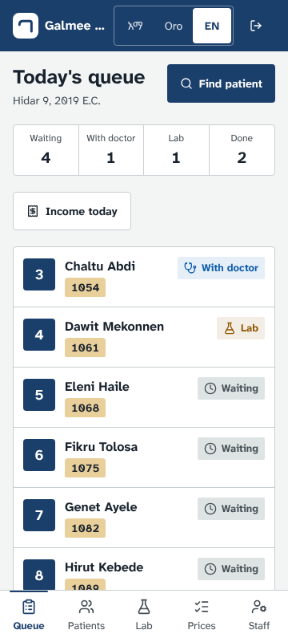
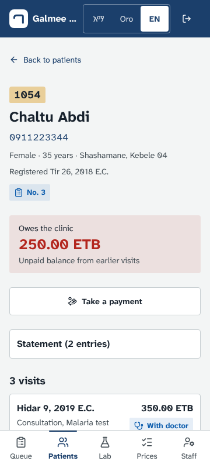
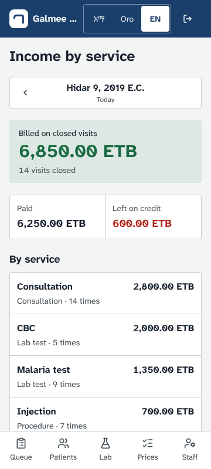

# Galmee Clinic

Find any patient's history in 3 seconds instead of searching the folder room.

Part of **Galmee**, business systems for Ethiopian businesses, by Alpha. Mobile-first PWA in Amharic, Afaan Oromo and English. Live at https://galmee-clinic.vercel.app.

- Frontend: Next.js + Tailwind (PWA, offline)
- Backend: Supabase (shared project `galmee`), Postgres RLS per business
- Payments: Chapa (Telebirr, CBE Birr); SMS: AfroMessage; alerts: Telegram

## Screens

Phone width (360 px), English, sample data:

| Today's queue | Patient card | Income by service |
| --- | --- | --- |
|  |  |  |

## Run it locally

Needs Node.js 22 and npm.

```sh
git clone https://github.com/Alphaguyasa/galmee-clinic
cd galmee-clinic
cp .env.example .env.local   # public values only, see below
npm ci
npm run dev                  # http://localhost:3000
```

Sign up on `/signup`: the first account creates a new clinic and becomes its owner. The owner then gives staff their clinic roles (doctor, lab, reception) on the Staff screen.

### Environment variables

| Name | Where | What |
| --- | --- | --- |
| `NEXT_PUBLIC_SUPABASE_URL` | `.env.local`, Vercel | The Supabase project URL |
| `NEXT_PUBLIC_SUPABASE_PUBLISHABLE_KEY` | `.env.local`, Vercel | The publishable (public) key. Row-level security decides what each signed-in user can read |

Both are public by design and are the only values the app needs. Server-side keys (SMS, Telegram, payments) live only in Supabase Edge Function secrets; never put them in `.env.local`, Vercel or the repo.

## Checks

```sh
npm run lint
npm test                     # unit tests (Vitest)
npm run build
npm audit --omit=dev
```

CI runs lint, tests and the build on every push and pull request (`.github/workflows/ci.yml`). Screenshots of every screen at 360 and 1280 px in Amharic and English: start a production build on port 3123, then `npm run screenshots` (see `scripts/screenshots.cjs`; logged-in screens need a demo login in `SHOT_EMAIL` / `SHOT_PASSWORD`).

## Database

All tables of this app start with `cl_` and live in the shared Galmee Supabase project, next to the shared core (businesses, users, customers, payments, credit, bookings, notifications).

- `supabase/migrations/`: every change, applied in file-name order. Each table has row-level security that limits rows to the user's own clinic; doctors' notes are readable by the doctor role only, lab data by doctor and lab, and every opening of a patient card is logged.
- `supabase/tests/`: SQL tests (cross-clinic isolation, roles, billing, appointments, reminders, demo data). Each runs in one block that ends with an exception, so nothing it writes is kept; the result line lists every check.
- Money moves only through database functions (`cl_close_visit_and_bill`, the core repayment function), each with a client reference so a repeated tap never bills twice.

## Deploy

The app is a standard Next.js project on Vercel:

1. Import the repo in Vercel (framework preset: Next.js).
2. Set the two environment variables above for Production and Preview.
3. Deploy. Every push to `main` deploys production.

The security headers (including a nonce-based Content Security Policy) are set by the app itself, so no Vercel header settings are needed.

## Your data

The owner can download everything the clinic has in Galmee as one Excel file from the home screen (patients, visits, bills, prices, staff, card openings, plus lab data and doctors' notes when the owner also holds that clinical role).

See `ROADMAP.md` for progress.
